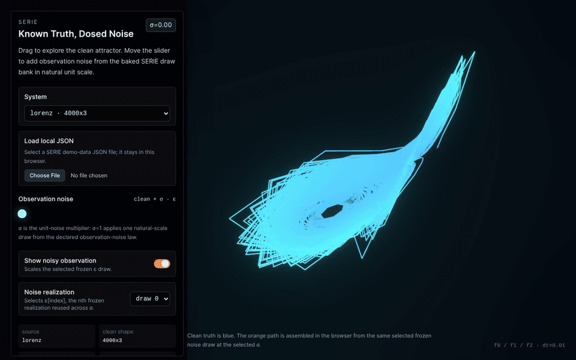

# SERIE

[](https://github.com/QilinWang/serie/actions/workflows/ci.yml)
[](https://github.com/QilinWang/serie/actions/workflows/pages-demo.yml)
[](https://pypi.org/project/serie/)
[](https://pepy.tech/project/serie)

[中文说明](README.zh-CN.md) · Rust engine: [**serie-rs**](https://crates.io/crates/serie-rs) ([source](https://github.com/qilinwang/serie-rs))

## Explore the interactive demo

[](https://qilinwang.github.io/serie/)

[**Open the interactive demo**](https://qilinwang.github.io/serie/) to choose
Lorenz, Rössler, or Chua, adjust observation noise, and select a noise
realization. Blue shows the clean trajectory; orange shows its noisy
observation. The demo visualizes synthetic data, not a forecast or a model
performance comparison.

**Build controlled time-series datasets to investigate how forecasting models
behave under changes in dynamics and observation noise.**

A good score on one dataset does not explain how a forecaster behaves when its
inputs change. SERIE lets you construct specific scenarios, inspect the generated
clean trajectory and injected noise, and prepare datasets for an evaluation.
You can use domain knowledge to choose the scenarios you want to examine.

A synthetic scenario is an explicit hypothesis about a system, not a guarantee
that it captures every real-world failure. SERIE supplies data; forecasts,
metrics and statistical conclusions come from the evaluation built around it.
Results describe the tested settings and do not certify deployment safety.

## What it lets you do

- **Specify changes in dynamics.** Configure a synthetic trajectory and
  interventions such as parameter or state changes, or a switch to another
  regime. This makes the simulated change and its timing explicit.
- **Vary observation noise.** Use Gaussian, Laplace or a custom noise sampler
  and scale a selected noise draw. The clean trajectory and the generated
  observation can be inspected separately.
- **Make paired noise comparisons.** For a fixed bank, trajectory and noise
  draw, changing sigma reuses that draw rather than sampling another one.
  Controlling this source of variation helps a comparison; a sound experiment
  still needs appropriate repetitions, metrics and statistical analysis.
- **Use a recorded series as a reference.** A supplied time-series array can
  be treated as the clean reference for additional observation noise. A real
  recording can itself contain measurement error, so it is not automatically
  the underlying physical truth.
- **Prepare reproducible evaluations.** Keep the source, settings, seeds,
  package version and generated artifacts with the evaluation. Sharing the
  generated data avoids depending on an unverified promise of byte-identical
  generation across all machines. A separate evaluation can use point or
  probabilistic metrics, including coverage, PIT or NLL when appropriate.

## How it works — a five-minute tour

The whole library is three nouns and two verbs. Hold this picture and the rest is detail:

    source  ──build_dgp_bank()──▶  DGP bank  ──inject_noise()──▶  split
   (what system)             (built once)              (one dosed dataset)

- A **source** is the system you want to test — a name like `"lorenz"`, a
  `TrajectorySpec` you configured, or a real recording you hand in.
- **`build_dgp_bank(source)`** does the expensive work *once*: it runs the clean
  trajectory and draws a frozen reservoir of noise. The result is a
  `DGPBank` — a bank of clean trajectory draws plus reusable noise
  draws, ready to be dosed.
- **`inject_noise(bank, sigma=...)`** is cheap and repeatable: it adds `sigma`
  worth of that frozen noise to the clean signal and hands back a ready-to-use
  train / validation / test split.

So the rhythm is always **build_dgp_bank once, inject_noise many times**:

```python
from serie import PartitionSpec, build_dgp_bank, inject_noise

# 1. Build a DGP bank once — the expensive call. It runs the clean Lorenz
#    trajectory and freezes a reservoir of noise draws.
bank = build_dgp_bank("lorenz", seed=42)

# 2. Inject a chosen noise dose. Cheap — call it as often as you like.
split = inject_noise(bank, sigma=0.1, partition=PartitionSpec.p70_20_10())

# 3. `split` is a partitioned dataset; stats come from the TRAIN split only.
print(split.train_values.shape)   # (T_train, D) — feed this to your model
print(split.train_stats.std)      # per-channel std, train only (no leakage)
```

### Why "build_dgp_bank once"?

The split between `build_dgp_bank` and `inject_noise` allows paired comparisons.
For the same trajectory and noise draw, each dose uses the same frozen noise:

```python
clean = inject_noise(bank, sigma=0.0)   # the pristine signal
mild  = inject_noise(bank, sigma=0.1)   # same signal + 0.1 × (the same noise)
harsh = inject_noise(bank, sigma=0.5)   # same signal + 0.5 × (the same noise)
```

In this example, the generated observations differ in their noise multiplier,
not in which underlying noise was drawn. This pairing is called **common random
numbers**. A single draw does not establish the typical model response; use
independent draws and account for other sources of variation in the evaluation.
Choosing different noise draws for each dose would remove this pairing.

(Want independent repeats on top? For deterministic sources, that means one
clean trajectory plus many noise draws. For stochastic sources, it
means paired trajectory and noise draws: `(trajectory_draw_ordinal=0,
noise_draw_ordinal=0)`, `(1, 1)`, and so on. That pairing is the unit of replication for
predictive-distribution tests.)

### Finding a breaking point

Because dosing is cheap, the natural move is to sweep — turn the noise up step by
step and watch where your model's forecasts fall apart:

```python
bank = build_dgp_bank("lorenz", seed=42)
for sigma in [0.0, 0.1, 0.25, 0.5, 1.0]:
    split = inject_noise(bank, sigma=sigma)
    error = evaluate(your_model, split)        # your own eval loop
    print(f"sigma={sigma}: error={error:.4f}")
```

The error-versus-`sigma` curve describes the model's response under the chosen
data and evaluation settings. Repeat over appropriate draws to assess variability.

### Bringing your own data

All of this works on a real recording too — hand `build_empirical_dgp_bank` a clean
`[T, D]` array instead of a system name:

```python
from serie import build_empirical_dgp_bank, inject_noise

bank = build_empirical_dgp_bank(my_array, name="wearable_gait")
split = inject_noise(bank, sigma=1.0, sigma_scale="train_std")
```

(`sigma_scale="train_std"` scales noise per channel by that channel's
training-split standard deviation — useful when channels have different physical
units.)

## Split samples by declared groups

Use the same saved train/validation/test membership for multiple models when
images, patients, or sequences belong to groups that must remain together:

```python
from serie import GroupShuffleSpec, SplitSample, SplitSource, StageSplitSamples

source = SplitSource(snapshot_id="illustration-v1", samples=(
    SplitSample(sample_id="image-a", group_id="person-1", label=0),
    SplitSample(sample_id="image-b", group_id="person-1", label=1),
    SplitSample(sample_id="image-c", group_id="person-2", label=-1),
    SplitSample(sample_id="image-d", group_id="person-3", label=2),
))
spec = GroupShuffleSpec(seed=17, train_groups=1, val_groups=1, test_groups=1)
manifest = StageSplitSamples(spec=spec) | source
manifest_bytes = manifest.to_json()  # save this once; reuse it for every model
print(manifest.summaries())          # actual group, sample and class counts
```

The seed and group counts above are illustrative, not defaults or an experiment
setting. Callers supply their own confirmed group identities, seed and split
plan. `StratifiedGroupFoldsSpec` additionally supports approximate class balance
using the optional `serie[split]` dependency. A manifest contains labels and
sample IDs, which may reveal labels; keep it on the data/assessment side, not
in model inputs. The [dataset split workflow](../../docs/how-to/dataset-splitting.qmd)
explains persistence, reuse, the two algorithms and their limits.

## Install

From PyPI:

```bash
python -m pip install serie
```

From this repository:

```bash
cd serie
python -m pip install -e ".[dev,diagnostics]"
```

With `uv`, a checkout can run the CLI without syncing a project environment.
The `--no-project --with-editable .` form builds a temporary/cached execution
environment from the local checkout and avoids touching a shared
`UV_PROJECT_ENVIRONMENT`:

```bash
cd serie
uv run --no-project --with-editable . serie walkthrough --out tmp/walkthrough --overwrite --format json
```

After installing from PyPI, use the shorter installed command:

```bash
serie walkthrough --out tmp/walkthrough --overwrite --format json
```

Runtime dependencies are `attrs`, `cappa`, `matplotlib`, `numpy`, and `polars`.

> CHG 2026-09-06: this older dependency list, and the one under Release
> Boundary below, predate the record migration. The current runtime dependencies
> are `pillow`, `msgspec`, `cappa`, `matplotlib`, `numpy`, `polars`, and
> `safetensors`, as declared in [pyproject.toml](pyproject.toml). `attrs` is no
> longer a SERIE dependency; it remains only in the parent repository's optional
> development dependencies for old/new comparison tests.

`cappa` provides the CLI, `matplotlib` renders source figures, and `polars` is
part of the known-recording loader path. `rich` is optional and only used for
diagnostic table rendering.

## Documentation

Detailed references live under [`docs/`](docs):

- [Command line API](docs/command_line.md) — every `serie` command, its options, and examples.
- [Python API](docs/python_api.md) — the programmable surface: `build_dgp_bank`, `inject_noise`, interventions, seed provenance, draw designs, and the stable import list.
- [Python walkthrough](docs/python_walkthrough.md) — a plain teaching tour of the primitives behind the CLI.
- [System presets](docs/system_presets.md) — stability notes and parameter choices for every built-in source.
- [Known datasets](docs/known_datasets.md) — bring-your-own recorded data and the expected on-disk layout.

## Release Boundary

Runtime dependencies are intentionally small and trainer-independent:

- `attrs`
- `cappa`
- `matplotlib`
- `numpy`
- `polars`

Optional diagnostic dependency:

- `rich`

SERIE must not depend on `torch`, Fern model modules, experiment registries,
result databases, or dashboard crates.

The default wheel ships one small prebuilt offline viewer template:
`serie/demo_dist/`, used by `serie demo` to produce a self-contained HTML
inspection artifact. That template is the only bundled frontend artifact. The
wheel does not bundle dashboards, `node_modules`, generated demo data, large
known datasets, generated arrays, model checkpoints, prediction windows,
reports, or run folders. User-requested artifacts from `serie generate --out`
or `export_dgp_bank_files(...)` are local verification artifacts owned by the
caller.

## Rust engine (serie-rs)

SERIE has a Rust sibling, [**serie-rs**](https://crates.io/crates/serie-rs)
([source](https://github.com/qilinwang/serie-rs)). The two are siblings over one
protocol, not a port: this Python package is the published, documented benchmark
surface (CLI, demos, the vocabulary papers cite), while `serie-rs` is the
data-plane engine — the same staged pipeline (`load → clean → inject_noise →
partition → ready`) and the same system family, implemented in Rust. It also reads
the grouped `dgp_bank.safetensors` this package writes (`serie generate
--array-format safetensors`), so you can build a bank once in Python and consume it
from Rust. (`serie` is already taken on crates.io, hence the `-rs` suffix.)

## Tests

### Record types and replacement

CHG 2026-09-06: data specifications, dynamical-system parameter records and
scientific report records use `msgspec.Struct`. CLI commands, pipeline stages,
world builders and owned time-series wrappers use standard-library dataclasses.
Neither package needs attrs to import or execute its own records. SERIE's
model-independent comparison and copy support lives in [records.py](records.py);
Fern imports it from SERIE, not the other way round.

The existing constructors and their checks remain public. Replacing a frozen
specification makes a new object and runs its construction checks again:

```python
from msgspec.structs import replace
from serie import TrajectorySpec

source = TrajectorySpec.lorenz(steps=128)
longer = replace(source, steps=256)
assert source.steps == 128
assert longer.steps == 256
```

Use `dataclasses.replace` for a dataclass stage instead. The attrs `evolve`,
`fields`, and `astuple` APIs no longer apply to migrated records. Parameter
consumers read declared fields in order without deep-copying their values.
Direct Python construction still executes the original converters and checks;
it does not magically enforce every type annotation. NumPy ownership, dtype,
read-only flags and unsupported copy cases retain their original contracts.
For example, owned time-series wrappers still reject pickling their immutable
metadata mapping rather than silently dropping it.

The parent repository's differential tests preserve old declarations as
test-only evidence. They compare construction, rejection, repr, field order,
copy and old pickle restoration; those baselines are not packaged with SERIE.
Earlier package examples and dependency lists above are historical where they
name attrs. No compatibility alias keeps that old runtime API alive.

### Package tests

```bash
cd serie
python -m pytest tests -q
```
