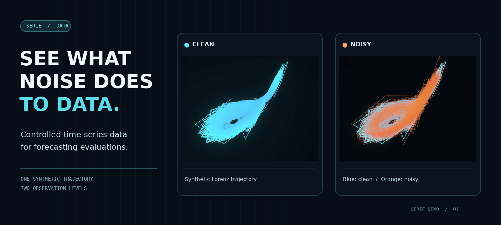

# SERIE

[](https://qilinwang.github.io/serie/)

**看见观测噪声如何改变时间序列。** [打开交互演示 →](https://qilinwang.github.io/serie/)

蓝色是合成的 Lorenz 轨迹，橙色是同一轨迹加入观测噪声后的结果；右图将两者叠加。

**构造受控的时间序列数据，研究预测模型面对机制变化和观测噪声时的表现。**

[English README](README.md)

你已经训练好了一个时间序列预测模型，验证集指标也不错。接下来可以问：**输入条件变化时，它的预测表现会怎样？**

桥梁通车前要做压力测试，芯片出厂前要过可靠性测试。预测模型也一样。如果它要参与交易、调度电力、监测设备故障，单靠一个历史 benchmark 分数是不够的。我们需要知道它在什么条件下还可靠，到了哪里会开始失效。

SERIE 用来构造受控的测试数据：你可以指定合成系统、干预和观测噪声，分别查看生成的干净轨迹和加入噪声后的观测。预测、指标计算和统计结论由使用这些数据的评估负责；误差也可能包含数据本身的随机性。

合成场景体现的是我们对系统可能遭遇的变化所作的假设。机制变化和观测噪声可以单独或组合测试，但有限场景不能覆盖所有现实情况，也不能证明部署安全。评估可以回答：

> 在我关心的条件下，这个模型能承受什么，不能承受什么？别人能不能用同样的种子和协议重新验证？

## SERIE 能做什么

### 设计你真正担心的机制变化

SERIE 不只提供一个固定的冲击菜单。你可以自己声明干预：

- 哪个参数发生漂移；
- 状态是否被突然踢了一下；
- 是否从某个时刻开始拼接到另一个机制；
- 这个变化发生在序列的什么位置。

这让领域知识进入测试过程。例如，可以把某种波动率冲击、执行器故障或负荷突变写成假设场景，再报告模型在该场景和所选评估条件下的表现。

### 调高你自己的噪声

真实观测噪声很少是完美高斯噪声。传感器可能有重尾异常值，通信链路可能出现突发噪声，某些测量误差还有实际物理单位。

SERIE 允许你提供自己的噪声分布，只要它是一个能生成数组的采样函数。然后你可以用同一批冻结的噪声 realization，逐步调高 `sigma`，观察模型误差从哪里开始恶化。

对于同一个 bank、轨迹和噪声 draw，改变 `sigma` 会复用同一份噪声，减少比较中由重新抽样带来的变化。实验的其余条件、重复次数和统计分析仍需另行控制。

### 测模型，而不是和数据纠缠

在真实数据上，模型出错时很难判断原因：是模型没学到？还是数据本身就含混？还是机制已经变了？

SERIE 的合成系统，如 Lorenz、Ornstein-Uhlenbeck、GARCH 等，有明确的数据生成过程。可以分别查看生成轨迹、注入的噪声与所设干预，并在报告误差时说明这些条件；这并不意味着误差完全来自模型。

### 公平比较模型和噪声剂量

SERIE 使用固定的噪声库，也就是 simulation 里常说的 **common random numbers**。同一个 DGP bank 中的噪声 draw 会在不同 `sigma` 下重复使用。

所以：

```text
sigma = 0.1: clean + 0.1 * same_noise
sigma = 0.5: clean + 0.5 * same_noise
```

这让噪声曲线更干净，也让模型之间的比较更公平。

### 检查不确定性是不是诚实

预测模型不只输出点预测，还经常输出区间、分布或置信度。一个“很自信但错得离谱”的模型比普通错误更危险。

如果模型提供了适当的预测区间或分布，可以在独立的评估中检查：

- coverage：90% 区间是否真的大约覆盖 90% 的真值；
- PIT：其分布是否符合所用校准检验的预期；
- NLL：实际结果在预测分布下的负对数似然。

这对概率预测、风险控制和下游决策尤其重要。

### 也可以带自己的干净数据

SERIE 不是 synthetic-only。你可以把一段已经清洗好的真实记录作为 `[T, D]` 数组交给它，比如机器人传感器、步态轨迹、生产环境里的某条干净序列。

SERIE 可以把它当成经验 DGP bank：以记录作为参考，再注入受控观测噪声、切分 train/validation/test。真实记录本身可能含有测量误差，不应自动视为底层物理真值。

## 五分钟理解 SERIE

SERIE 的核心节奏是：

```text
source  ──build_dgp_bank()──▶  DGP bank  ──inject_noise()──▶  split
系统          构建一次              多次注入噪声             训练/验证/测试数据
```

三个对象：

- **source**：你要测试的系统。可以是 `"lorenz"` 这样的内置名字，也可以是你自己配置的 `TrajectorySpec`，还可以是真实数组。
- **DGP bank**：一次性构建出来的数据生成库。里面有干净轨迹、冻结噪声 draw、种子信息和协议版本。
- **split**：某个具体 `sigma` 下的 train/validation/test 切分结果。

两个动作：

- **`build_dgp_bank(...)`**：昂贵操作，只做一次。
- **`inject_noise(...)`**：便宜操作，可以对同一个 bank 反复调用不同的 `sigma`。

最小 Python 例子：

```python
from serie import PartitionSpec, build_dgp_bank, inject_noise

bank = build_dgp_bank("lorenz", seed=42)

split = inject_noise(
    bank,
    sigma=0.1,
    partition=PartitionSpec.p70_20_10(),
)

print(split.train_values.shape)
print(split.train_stats.std)
```

`split.train_stats` 只来自训练段，不会偷看 validation/test。这一点对 `sigma_scale="train_std"` 尤其重要，因为噪声按训练段的标准差缩放，不能用全序列统计量泄漏未来信息。

## 为什么要先 build，再 inject？

如果你每个 `sigma` 都重新生成一次噪声，那么误差曲线会混入随机抽样本身的波动。

SERIE 的做法是：

```python
bank = build_dgp_bank("lorenz", seed=42)

clean = inject_noise(bank, sigma=0.0)
mild = inject_noise(bank, sigma=0.1)
harsh = inject_noise(bank, sigma=0.5)
```

`mild` 和 `harsh` 复用了相同的轨迹和噪声 draw，观测数据中的区别是噪声倍率。这个配对控制了一项随机变化；要评价模型的典型表现，还需要独立重复，并考虑评估中的其他随机因素。

对于 deterministic 系统，一个干净轨迹配多组观测噪声通常就够了。对于 stochastic 系统，SERIE 默认把 trajectory draw 和 noise draw 按 ordinal 配对：`(0, 0)`, `(1, 1)`, `(2, 2)`。每一对代表一个联合未来 realization，这是做预测分布评估时更自然的复制单位。

## 安装

从 PyPI 安装：

```bash
python -m pip install serie
```

如果你使用 `uv`：

```bash
uv pip install serie
```

从源码开发：

```bash
git clone https://github.com/QilinWang/serie.git
cd serie
python -m pip install -e ".[dev,diagnostics]"
```

## 命令行快速上手

安装后会得到一个命令：

```bash
serie
```

命令结构是：

```bash
serie <subcommand> <source> --option value
```

例如：

```bash
serie generate lorenz --shock param --sigma 0.1
```

读作：

- `serie`：运行 SERIE CLI；
- `generate`：生成一个 SERIE dataset cell；
- `lorenz`：使用 Lorenz source；
- `--shock param`：使用内置参数冲击干预；
- `--sigma 0.1`：观测噪声剂量；
- `generate`：始终输出 JSON，方便人和脚本读取。

第一次安装后，先跑这三条：

```bash
serie list-data-ids
serie demo lorenz --out-html tmp/lorenz_demo.html
serie generate lorenz --sigma 0.1
```

它们分别做三件事：

1. 看看有哪些内置 source；
2. 生成一个离线交互式 Lorenz attractor HTML；
3. 生成一个 dataset cell，并返回 train/validation/test 切分摘要。

如果你想做完整安装检查，再跑：

```bash
serie list-cli-commands --format json
serie show-data-dir --format json
serie generate ou --sigma 0.1
serie generate lorenz --shock param --sigma 0.1 --out tmp/lorenz_cell --array-format all --plot both
serie walkthrough --out tmp/walkthrough --array-format all --overwrite --format json
```

## 常用 CLI

### 查看命令列表

```bash
serie list-cli-commands
serie list-cli-commands --format json
```

### 查看内置数据源

```bash
serie list-data-ids --format json
```

### 生成一个 SERIE cell

```bash
serie generate lorenz --sigma 0.25
serie generate lorenz --shock param --sigma 0.1 --out tmp/lorenz_cell --array-format csv --plot both
serie generate ou --sigma 1.0 --sigma-scale train_std
```

`generate` 是主要 CLI：它会生成 source，按需要加入干预，注入观测噪声，切分 train/validation/test，并且可以选择写出数组和图。输出 JSON 会包含 DGP bank 摘要和 cell 切分摘要。

- `--shock none|param|state|switch`：选择干预类型。比如 `lorenz --shock param` 会解析成 `lorenz_param_shock`。
- `--sigma`：观测噪声剂量。
- `--sigma-scale unit`：直接使用 `sigma`。
- `--sigma-scale train_std`：按训练段每个通道的标准差缩放噪声，适合不同通道有不同物理单位的真实记录。这个模式目前用于 JSON 切分摘要；如果要同时写数组或图，请使用 `--sigma-scale unit`。
- `--out`：写文件的根目录。不传 `--out` 时只打印 JSON 摘要；传入后文件会写到稳定的 `<source>_<cell-hash>` 子目录。
- `--array-format none|npy|csv|ipc|parquet|table|all`：写出数组和 `manifest.json`。
- `--plot none|timeseries|attractor|both`：写出静态图。

### 生成交互式 HTML demo

```bash
serie demo lorenz --out-html tmp/lorenz_demo.html
serie demo rossler --out-html tmp/rossler_demo.html --n-draws 30 --overwrite
serie demo chua --out-html tmp/chua_demo.html --n-points 4000 --n-draws 30 --overwrite
serie demo henon --out-dir tmp/henon_demo_pack --overwrite
```

生成的是一个单文件 HTML。浏览器里可以拖拽 3D attractor，滑动 `sigma` 实时看到：

```text
clean + sigma * noise_draw
```

这里的 `sigma` 是 unit-noise scale 下的自然噪声倍率。`Noise realization` 下拉框选择的是第几个冻结噪声 realization；同一个 realization 会在不同 `sigma` 下重复使用。

这些 HTML 很适合放到 GitHub Release 或静态网站作为展示材料，但不应该打进 PyPI wheel。PyPI 包里只带一个小的 viewer template，真正的数据由 `serie demo` 在本地生成后内联进 HTML。

如果你想一次得到一个检查用文件夹，用 `--out-dir`。它会写出
`index.html`、`arrays/` 里的 IPC 数组，以及 `static/` 里的 PNG 图。只有在你
额外传 `--data-out path/to/demo.json` 时，才会单独写出 browser JSON payload。
普通 `--out-html` 仍然是最适合分享的单文件 HTML。

## Python API

### 构建一次，多次注入

```python
from serie import build_dgp_bank, inject_noise

bank = build_dgp_bank("lorenz", seed=42, n_noise_draws=8)

for sigma in [0.0, 0.1, 0.25, 0.5]:
    split = inject_noise(bank, sigma=sigma)
    print(sigma, split.values.shape)
```

### 使用真实干净数据

```python
from serie import build_empirical_dgp_bank, inject_noise

bank = build_empirical_dgp_bank(values, name="wearable_gait")
split = inject_noise(bank, sigma=1.0, sigma_scale="train_std")
```

`values` 应该是 `[T, D]` 形状的干净数组。SERIE 会在它上面构建冻结噪声 draw，并按你指定的 `sigma` 生成观测序列。

### 自定义噪声分布

```python
def laplace_noise(rng, shape):
    return rng.laplace(0.0, 1.0 / 2**0.5, size=shape)

bank = build_dgp_bank("lorenz", noise_kind=laplace_noise)
split = inject_noise(bank, sigma=0.2)
```

SERIE 内置噪声默认是 unit variance，这样 `sigma` 可以直接理解为噪声标准差倍率。自定义噪声不强制必须 unit variance；真正要求是你知道并声明噪声分布。只是如果你想公平比较不同分布的“形状”而不是“能量”，unit variance 是最清楚的约定。

### 干预

```python
from attrs import evolve
from serie import ShockEvent, ShockSchedule, TrajectorySpec, build_dgp_bank

base = TrajectorySpec.lorenz()
source = evolve(
    base,
    shocks=ShockSchedule.single(
        ShockEvent.params_step_change(
            params_after=evolve(base.params, rho=35.0),
            t_start=0.60,
        )
    ),
)
bank = build_dgp_bank(source, seed=42)
```

SERIE 支持多个按时间排序的参数干预和状态干预；例如可以先做
`params_stepped_transition(...)`，再做 `state_perturbation(...)`。`trajectory_switch(...)`
仍然保持单事件，因为 trajectory switch 是在两条独立生成的轨迹之间切换，不是在同一条积分轨迹里原地扰动。

### 种子和 draw ordinal

SERIE 使用 `np.random.SeedSequence(...).spawn(...)` 生成独立 child seeds。不要把 `seed + i` 当成独立随机流。

需要区分两件事：

- `*_seed_base`：你传入的根种子，用来重新生成整个 draw bank；
- `*_draw_ordinal`：第几个 spawn/draw，也就是重建某个 draw 所需的 ordinal；
- `*_draw_seed`：由根种子和 ordinal 派生出的 child seed，方便审计和对照。

因此 `noise_draw_ordinal=3` 的意思不是“随机数种子是 3”，而是使用这个 bank 中索引为 3 的冻结噪声 realization，即从 0 开始计数时的第 4 个。它对应的 child seed 会记录在 metadata 里。

## 发布边界

SERIE 的 PyPI wheel 保持为数据层和轻量查看器：

- Python API；
- CLI；
- plotting；
- `serie demo` 所需的小型 `demo_dist/` viewer template。

它不打包：

- 大型已知数据集；
- 生成好的 HTML demo；
- `node_modules`；
- dashboard；
- 模型 checkpoint；
- 实验结果数据库；
- run folders。

生成的 Lorenz/Rossler/Chua HTML demo 应该作为 GitHub Release assets 或静态网站发布，而不是进入 wheel。

## 已知数据集

默认 wheel 不包含大型真实数据集。外部数据默认放在：

```bash
serie show-data-dir --format json
```

打印出来的位置，或者通过 `SERIE_KNOWN_ROOT` 指定。

这保持了包本身的干净，也避免让用户在安装一个库时被迫下载几百 MB 数据。

## 测试

从源码目录运行：

```bash
pytest
```

或用 `uv`：

```bash
uv run --no-project --with-editable ".[dev,diagnostics]" pytest
```

测试覆盖的重点不是普通 smoke test，而是 SERIE 的实验承诺：

- `sigma=0` 返回干净数据；
- 同一个 bank 下不同 `sigma` 复用同一批噪声 realization；
- train/validation/test 统计不泄漏；
- stochastic source 默认使用 paired trajectory/noise draws；
- 导出 manifest 能回读；
- CLI payload 和 Python API 保持一致。

## 引用

SERIE 的思想来自两条线：

- controlled noise titration：用可控噪声扫描模型分辨率和鲁棒性边界；
- interventionist shocks：用明确声明的机制变化测试预测模型在分布变化下的行为。

如果你在论文或项目中使用 SERIE，请同时报告 source、seed、protocol version、`sigma`、`sigma_scale`、draw design 和干预定义。这样别人才能复现你测试的具体条件。
